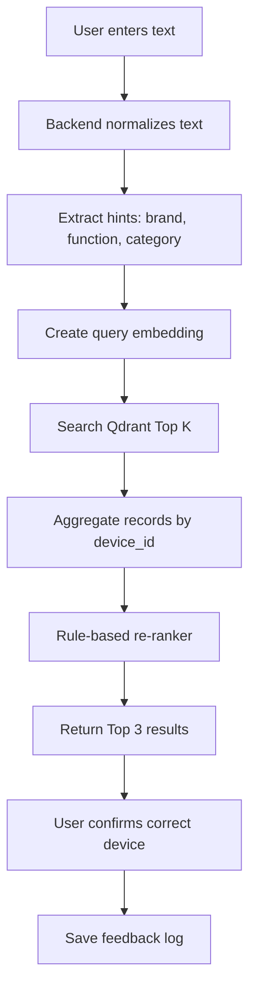
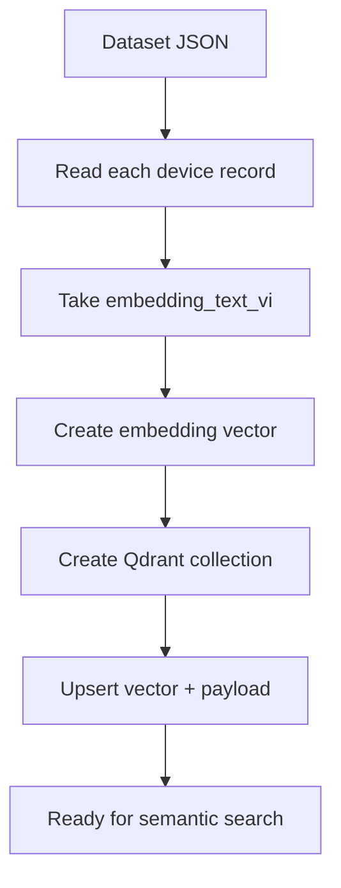
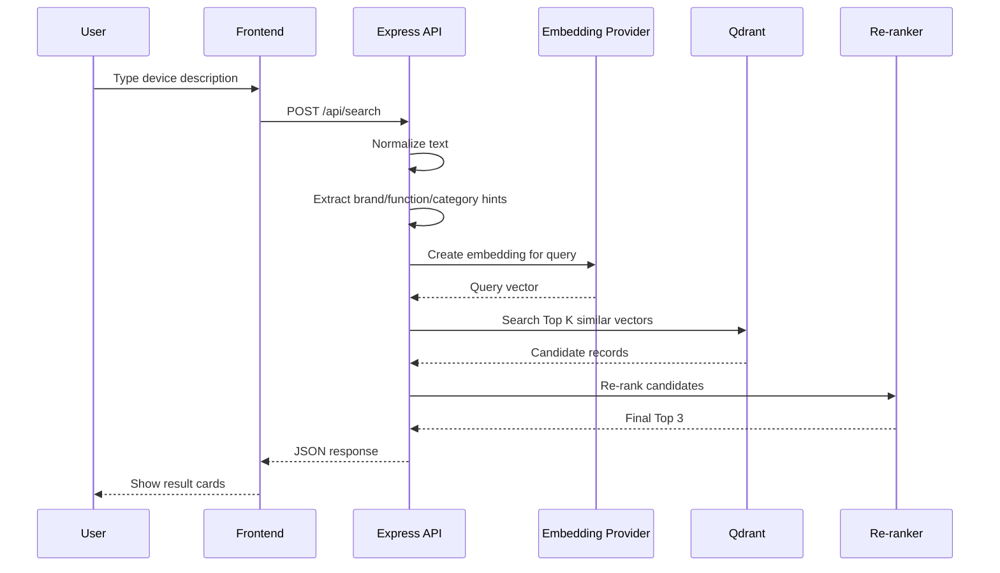

# Use Case 1 Implementation Plan

## Project

**Basic app for surgical device text search**

This plan is for building a small proof of concept app for **Use Case 1: finding surgical devices from short text descriptions**.

The first version does **not** need speech-to-text. The user will type text such as:

```txt
lấy dao siêu âm J&J vừa cắt vừa hàn mạch
```

The app should return the most likely surgical devices from the dataset, for example:

```txt
1. HARMONIC ACE+7
2. LigaSure Maryland Jaw
3. ENSEAL X1
```

The goal is not to create a production medical system yet. The goal is to prove this basic flow:

```txt
Text input
→ Embedding
→ Qdrant vector search
→ Re-ranker
→ Top 3 device suggestions
→ User confirms the correct device
```

---

## Important note

This is a prototype for search and retrieval. It should **not** be used as a clinical decision system. In a real OR or hospital setting, the final selected device must be confirmed by a trained human user, and the dataset must be reviewed by a clinical or inventory owner.

For the first version, the system should always return **Top 3 results** rather than automatically selecting one device.

---

## References used for the technical direction

- Qdrant is used as a vector database for storing vectors with payloads and searching by vector similarity.
  - https://qdrant.tech/documentation/quickstart/
  - https://qdrant.tech/documentation/manage-data/collections/
  - https://qdrant.tech/documentation/concepts/points/
  - https://qdrant.tech/documentation/concepts/filtering/
- OpenAI embeddings can be used to turn text into numerical vectors for semantic search.
  - https://developers.openai.com/api/docs/guides/embeddings
  - https://developers.openai.com/api/docs/models/text-embedding-3-small
- Surgical tool dataset reference repo used earlier for enrichment ideas.
  - https://github.com/luiscarlosgph/list-of-surgical-tool-datasets

---

## What the app should do

### User story

As a user in the surgical operation context, I want to type a natural-language description of a surgical device so that I can quickly find the correct device without knowing the exact official name.

Example user inputs:

```txt
lấy dao siêu âm J&J
cây harmonic vừa cắt vừa hàn mạch
kẹp hàn mạch medtronic
cái túi lấy bệnh phẩm nội soi
cây móc đốt nội soi
kìm sinh thiết nội soi
cây hút rửa ổ bụng
```

Expected output:

```txt
Top results:
1. Device name
2. Device name
3. Device name

For each result:
- official_name
- category
- manufacturer_or_owner
- aliases_vi
- functions
- score
- reason why this result was returned
```

---

## Dataset

Use the generated dataset file:

```txt
surgical_device_dataset_v2_enriched.json
```

Recommended project location:

```txt
data/surgical_device_dataset_v2_enriched.json
```

The dataset has **100 records** and these columns/fields:

```txt
device_id
official_name
record_type
manufacturer_or_owner
brand_terms_text
category
sub_category
aliases_vi_text
aliases_en_text
functions_text
departments_text
example_queries_text
embedding_text_vi
source_hint
source_url
notes
```

### Important fields

#### `device_id`

Unique ID of the record.

Example:

```txt
DEV001
```

#### `official_name`

The main display name of the device.

Example:

```txt
HARMONIC ACE+7
```

#### `aliases_vi_text`

Vietnamese aliases and common names.

Example:

```txt
dao siêu âm; dao harmonic; dao J&J; cây harmonic; cây cắt hàn mạch
```

This is very important for the Vietnamese text search use case.

#### `functions_text`

Device functions.

Example:

```txt
cut; coagulate; seal vessel; dissect tissue
```

This is useful for the re-ranker.

#### `embedding_text_vi`

This is the main text that should be sent to the embedding model.

Example:

```txt
HARMONIC ACE+7. Hãng/brand: HARMONIC; J&J; Ethicon; Johnson & Johnson. Loại thiết bị: Energy / Ultrasonic - Ultrasonic scalpel. Tên gọi tiếng Việt/alias: dao siêu âm; dao harmonic; dao J&J; cây harmonic; cây cắt hàn mạch. Tên gọi tiếng Anh: harmonic scalpel; ultrasonic scalpel; ultrasonic surgical device. Chức năng: cut; coagulate; seal vessel; dissect tissue. Ngữ cảnh sử dụng: general surgery; laparoscopy; gynecology. Ví dụ người dùng có thể nói: lấy dao siêu âm J&J | cây harmonic vừa cắt vừa hàn mạch | dao siêu âm để cầm máu.
```

This text combines official name, aliases, category, functions, department context, and example queries. It gives the embedding model more meaning than just embedding the official device name.

---

## Architecture

### Simple version



### Indexing flow



### Runtime search flow



---

## Recommended stack

Use the simplest possible stack for the first prototype.

```txt
Backend: Node.js + Express
Frontend: Plain HTML + JavaScript
Vector DB: Qdrant using Docker
Embedding: OpenAI-compatible embedding API from mentor
Dataset: surgical_device_dataset_v2_enriched.json
```

Reasoning:

- Plain HTML is enough for the first UI.
- Node + Express is quick to build.
- Qdrant is open source and easy to run locally with Docker.
- Keeping everything simple makes it easier to test the actual retrieval flow.

---

## Final project structure

```txt
medical-device-search-app/
│
├── docker-compose.yml
├── package.json
├── .env.example
├── .gitignore
├── README.md
│
├── data/
│   └── surgical_device_dataset_v2_enriched.json
│
├── storage/
│   ├── embedding_cache.json
│   └── feedback_log.jsonl
│
├── public/
│   ├── index.html
│   ├── app.js
│   └── styles.css
│
├── scripts/
│   ├── seed.js
│   ├── check-qdrant.js
│   └── evaluate.js
│
├── src/
│   ├── server.js
│   ├── config.js
│   │
│   ├── services/
│   │   ├── embeddingService.js
│   │   ├── qdrantService.js
│   │   ├── textProcessing.js
│   │   ├── hintExtractor.js
│   │   ├── reranker.js
│   │   └── feedbackService.js
│   │
│   └── routes/
│       ├── searchRoutes.js
│       ├── deviceRoutes.js
│       └── feedbackRoutes.js
│
└── tests/
    └── test_queries.json
```

---

## Environment variables

Create `.env.example`:

```env
# Server
PORT=3000
NODE_ENV=development

# Embedding provider
# For mentor-provided keys, this can be OpenAI or another OpenAI-compatible endpoint.
EMBEDDING_PROVIDER=openai_compatible
OPENAI_API_KEY=replace_with_real_key
OPENAI_BASE_URL=
EMBEDDING_MODEL=text-embedding-3-small

# If the provider allows custom output dimensions, keep this empty first.
# The seed script can detect vector length from the first embedding.
EMBEDDING_DIM=

# Qdrant
QDRANT_URL=http://localhost:6333
QDRANT_API_KEY=
QDRANT_COLLECTION=surgical_devices_v1
QDRANT_DISTANCE=Cosine

# Search behavior
SEARCH_TOP_K=20
RETURN_LIMIT=3

# Debugging
SHOW_DEBUG=true
```

Create `.gitignore`:

```gitignore
node_modules/
.env
storage/embedding_cache.json
storage/feedback_log.jsonl
.DS_Store
```

Important:

- Never put the embedding API key in frontend code.
- Keep the key only in `.env` on the backend.
- Do not commit `.env` to GitHub.

---

## Docker setup for Qdrant

Create `docker-compose.yml`:

```yml
services:
  qdrant:
    image: qdrant/qdrant:latest
    ports:
      - "6333:6333"
      - "6334:6334"
    volumes:
      - qdrant_storage:/qdrant/storage

volumes:
  qdrant_storage:
```

Run Qdrant:

```bash
docker compose up -d
```

Check Qdrant:

```bash
curl http://localhost:6333
```

Expected response should show that Qdrant is running.

Optional dashboard:

```txt
http://localhost:6333/dashboard
```

---

## Package setup

Create `package.json`:

```json
{
  "name": "medical-device-search-app",
  "version": "1.0.0",
  "type": "module",
  "scripts": {
    "dev": "node src/server.js",
    "seed": "node scripts/seed.js",
    "check:qdrant": "node scripts/check-qdrant.js",
    "evaluate": "node scripts/evaluate.js"
  },
  "dependencies": {
    "cors": "^2.8.5",
    "dotenv": "^16.4.7",
    "express": "^4.18.3",
    "openai": "^4.80.0"
  }
}
```

Install packages:

```bash
npm install
```

---

## Backend implementation details

### `src/config.js`

Purpose:

- Read environment variables.
- Provide one central config object.

```js
import "dotenv/config";

export const config = {
  port: Number(process.env.PORT || 3000),
  nodeEnv: process.env.NODE_ENV || "development",

  embeddingProvider: process.env.EMBEDDING_PROVIDER || "openai_compatible",
  openaiApiKey: process.env.OPENAI_API_KEY,
  openaiBaseUrl: process.env.OPENAI_BASE_URL || undefined,
  embeddingModel: process.env.EMBEDDING_MODEL || "text-embedding-3-small",
  embeddingDim: process.env.EMBEDDING_DIM ? Number(process.env.EMBEDDING_DIM) : null,

  qdrantUrl: process.env.QDRANT_URL || "http://localhost:6333",
  qdrantApiKey: process.env.QDRANT_API_KEY || "",
  qdrantCollection: process.env.QDRANT_COLLECTION || "surgical_devices_v1",
  qdrantDistance: process.env.QDRANT_DISTANCE || "Cosine",

  searchTopK: Number(process.env.SEARCH_TOP_K || 20),
  returnLimit: Number(process.env.RETURN_LIMIT || 3),
  showDebug: String(process.env.SHOW_DEBUG || "true") === "true"
};
```

---

## Embedding service

### Why this service exists

The embedding service converts text into a vector.

Example:

```txt
"dao siêu âm J&J cắt hàn mạch"
```

becomes something like:

```txt
[0.012, -0.44, 0.98, ...]
```

This vector is then used to search Qdrant.

### `src/services/embeddingService.js`

```js
import OpenAI from "openai";
import { config } from "../config.js";

let client;

function getClient() {
  if (!client) {
    if (!config.openaiApiKey) {
      throw new Error("OPENAI_API_KEY is missing. Add it to your .env file.");
    }

    client = new OpenAI({
      apiKey: config.openaiApiKey,
      baseURL: config.openaiBaseUrl
    });
  }

  return client;
}

export async function embedText(text) {
  if (!text || !text.trim()) {
    throw new Error("Cannot embed empty text.");
  }

  const response = await getClient().embeddings.create({
    model: config.embeddingModel,
    input: text
  });

  const vector = response.data?.[0]?.embedding;

  if (!Array.isArray(vector) || vector.length === 0) {
    throw new Error("Embedding provider returned an invalid vector.");
  }

  return vector;
}
```

### Notes

- If mentor gives an OpenAI-compatible endpoint, set `OPENAI_BASE_URL`.
- If mentor gives a normal OpenAI key, leave `OPENAI_BASE_URL` empty.
- If mentor uses Azure OpenAI, the code may need a small adapter depending on their endpoint format.

---

## Qdrant service

### What Qdrant stores

Each Qdrant point should contain:

```txt
id: numeric or UUID point ID
vector: embedding vector
payload: original device information
```

Payload example:

```json
{
  "device_id": "DEV001",
  "official_name": "HARMONIC ACE+7",
  "manufacturer_or_owner": "Ethicon / Johnson & Johnson",
  "brand_terms_text": "HARMONIC; J&J; Ethicon; Johnson & Johnson",
  "category": "Energy / Ultrasonic",
  "sub_category": "Ultrasonic scalpel",
  "aliases_vi_text": "dao siêu âm; dao harmonic; dao J&J; cây harmonic; cây cắt hàn mạch",
  "aliases_en_text": "harmonic scalpel; ultrasonic scalpel; ultrasonic surgical device",
  "functions_text": "cut; coagulate; seal vessel; dissect tissue",
  "departments_text": "general surgery; laparoscopy; gynecology",
  "embedding_text_vi": "..."
}
```

### `src/services/qdrantService.js`

This version uses REST so it does not depend on a specific SDK.

```js
import { config } from "../config.js";

function headers() {
  const h = {
    "Content-Type": "application/json"
  };

  if (config.qdrantApiKey) {
    h["api-key"] = config.qdrantApiKey;
  }

  return h;
}

async function qdrantRequest(path, options = {}) {
  const response = await fetch(`${config.qdrantUrl}${path}`, {
    method: options.method || "GET",
    headers: headers(),
    body: options.body ? JSON.stringify(options.body) : undefined
  });

  const data = await response.json().catch(() => ({}));

  if (!response.ok) {
    throw new Error(`Qdrant error ${response.status}: ${JSON.stringify(data)}`);
  }

  return data;
}

export async function getCollection() {
  return qdrantRequest(`/collections/${config.qdrantCollection}`);
}

export async function deleteCollectionIfExists() {
  const response = await fetch(`${config.qdrantUrl}/collections/${config.qdrantCollection}`, {
    method: "DELETE",
    headers: headers()
  });

  if (![200, 202, 404].includes(response.status)) {
    const data = await response.json().catch(() => ({}));
    throw new Error(`Failed to delete Qdrant collection: ${response.status} ${JSON.stringify(data)}`);
  }
}

export async function createCollection(vectorSize) {
  return qdrantRequest(`/collections/${config.qdrantCollection}`, {
    method: "PUT",
    body: {
      vectors: {
        size: vectorSize,
        distance: config.qdrantDistance
      }
    }
  });
}

export async function recreateCollection(vectorSize) {
  await deleteCollectionIfExists();
  await createCollection(vectorSize);
}

export async function upsertPoints(points) {
  return qdrantRequest(`/collections/${config.qdrantCollection}/points?wait=true`, {
    method: "PUT",
    body: {
      points
    }
  });
}

export async function searchPoints(vector, limit = 20) {
  // Newer Qdrant versions support /points/query.
  // Some older setups may use /points/search.
  // Try /points/query first, then fallback to /points/search.

  try {
    const queryResult = await qdrantRequest(`/collections/${config.qdrantCollection}/points/query`, {
      method: "POST",
      body: {
        query: vector,
        limit,
        with_payload: true
      }
    });

    return normalizeQdrantResults(queryResult);
  } catch (error) {
    const searchResult = await qdrantRequest(`/collections/${config.qdrantCollection}/points/search`, {
      method: "POST",
      body: {
        vector,
        limit,
        with_payload: true
      }
    });

    return normalizeQdrantResults(searchResult);
  }
}

function normalizeQdrantResults(raw) {
  if (Array.isArray(raw.result)) {
    return raw.result;
  }

  if (Array.isArray(raw.result?.points)) {
    return raw.result.points;
  }

  return [];
}
```

---

## Text processing

### Why this is needed

Vietnamese user input may contain accents or no accents.

These should be treated similarly:

```txt
dao siêu âm
```

```txt
dao sieu am
```

### `src/services/textProcessing.js`

```js
export function stripVietnamese(text) {
  return String(text || "")
    .normalize("NFD")
    .replace(/[\u0300-\u036f]/g, "")
    .replace(/đ/g, "d")
    .replace(/Đ/g, "D");
}

export function normalizeText(text) {
  return stripVietnamese(text)
    .toLowerCase()
    .replace(/[^\p{L}\p{N}&+\-\/ ]/gu, " ")
    .replace(/\s+/g, " ")
    .trim();
}

export function splitSemiColonText(text) {
  return String(text || "")
    .split(";")
    .map(x => x.trim())
    .filter(Boolean);
}

export function normalizedIncludes(text, keyword) {
  const t = normalizeText(text);
  const k = normalizeText(keyword);
  return Boolean(k) && t.includes(k);
}
```

---

## Hint extractor

### Purpose

Qdrant finds semantically similar records. But we also want to detect important hard signals, such as:

```txt
J&J
Medtronic
siêu âm
hàn mạch
nội soi
clip
sinh thiết
hút rửa
```

These signals are used by the re-ranker.

### `src/services/hintExtractor.js`

```js
import { normalizeText } from "./textProcessing.js";

const BRAND_PATTERNS = [
  { value: "J&J", terms: ["j&j", "johnson", "ethicon", "harmonic"] },
  { value: "Medtronic", terms: ["medtronic", "covidien", "ligasure", "sonicision"] },
  { value: "Olympus", terms: ["olympus", "sonosurg"] },
  { value: "Karl Storz", terms: ["karl storz", "storz"] },
  { value: "Stryker", terms: ["stryker"] },
  { value: "ConMed", terms: ["conmed"] },
  { value: "Intuitive", terms: ["intuitive", "da vinci", "robotic"] },
  { value: "Boston Scientific", terms: ["boston", "boston scientific"] },
  { value: "Cook Medical", terms: ["cook", "cook medical"] }
];

const FUNCTION_PATTERNS = [
  { value: "cut", terms: ["cat", "cắt", "cut", "scissor", "scissors", "keo", "kéo"] },
  { value: "coagulate", terms: ["cam mau", "cầm máu", "coagulate", "coagulation", "dot", "đốt"] },
  { value: "seal vessel", terms: ["han mach", "hàn mạch", "seal", "vessel sealing", "ligasure"] },
  { value: "grasp", terms: ["kep", "kẹp", "gap", "gắp", "grasper", "forceps", "clamp"] },
  { value: "clip", terms: ["clip", "kep clip", "kẹp clip", "clip applier", "clipper"] },
  { value: "suction", terms: ["hut", "hút", "suction"] },
  { value: "irrigation", terms: ["rua", "rửa", "irrigation", "irrigator"] },
  { value: "biopsy", terms: ["sinh thiet", "sinh thiết", "biopsy"] },
  { value: "staple", terms: ["stapler", "bam noi", "bấm nối", "ghim", "staple"] },
  { value: "suture", terms: ["khau", "khâu", "suture", "needle holder", "kim khau", "kim khâu"] },
  { value: "retrieve specimen", terms: ["lay benh pham", "lấy bệnh phẩm", "specimen bag", "retrieval bag", "tui lay", "túi lấy"] }
];

const CATEGORY_PATTERNS = [
  { value: "ultrasonic", terms: ["sieu am", "siêu âm", "ultrasonic", "harmonic"] },
  { value: "vessel sealing", terms: ["han mach", "hàn mạch", "vessel", "ligasure", "enseal"] },
  { value: "laparoscopic", terms: ["noi soi", "nội soi", "laparoscopic", "laparoscopy"] },
  { value: "endoscopic", terms: ["noi soi tieu hoa", "nội soi tiêu hóa", "endoscopic", "endoscopy", "ercp"] },
  { value: "robotic", terms: ["robot", "robotic", "da vinci"] },
  { value: "camera", terms: ["camera", "scope", "laparoscope", "ống soi", "ong soi"] }
];

function findMatches(normalizedInput, patterns) {
  const result = [];

  for (const pattern of patterns) {
    for (const term of pattern.terms) {
      if (normalizedInput.includes(normalizeText(term))) {
        result.push(pattern.value);
        break;
      }
    }
  }

  return [...new Set(result)];
}

export function extractHints(inputText) {
  const normalized = normalizeText(inputText);

  return {
    normalized_query: normalized,
    brands: findMatches(normalized, BRAND_PATTERNS),
    functions: findMatches(normalized, FUNCTION_PATTERNS),
    categories: findMatches(normalized, CATEGORY_PATTERNS)
  };
}
```

---

## Re-ranker

### Why re-ranker is needed

Qdrant is good at semantic search, but sometimes it returns records that are semantically close but not the best fit.

Example:

```txt
User: dao siêu âm J&J vừa cắt vừa hàn mạch
```

Qdrant may return several ultrasonic tools because they are all semantically similar.

The re-ranker pushes the best record higher by checking:

```txt
- Does the alias match exactly?
- Does the brand match?
- Do the functions match?
- Does the category match?
- Is the official name mentioned?
```

### Score formula for prototype

Use this simple formula:

```txt
final_score = vector_score
            + alias_bonus
            + brand_bonus
            + function_bonus
            + category_bonus
            + official_name_bonus
```

Recommended weights:

```txt
official_name_bonus = +0.15
alias_bonus         = +0.12
brand_bonus         = +0.10
function_bonus      = +0.05 per matched function, max +0.20
category_bonus      = +0.07 per matched category, max +0.14
```

### `src/services/reranker.js`

```js
import { normalizeText, splitSemiColonText } from "./textProcessing.js";

function textMatchesAny(queryNorm, values) {
  for (const value of values) {
    const v = normalizeText(value);
    if (v && queryNorm.includes(v)) {
      return true;
    }
  }
  return false;
}

function countPayloadMatches(hints, payloadText) {
  const payloadNorm = normalizeText(payloadText || "");
  let count = 0;

  for (const hint of hints) {
    const h = normalizeText(hint);
    if (h && payloadNorm.includes(h)) {
      count += 1;
    }
  }

  return count;
}

function buildReason({ officialNameMatched, aliasMatched, brandMatches, functionMatches, categoryMatches }) {
  const reasons = [];

  if (officialNameMatched) reasons.push("official name matched the query");
  if (aliasMatched) reasons.push("Vietnamese alias matched the query");
  if (brandMatches > 0) reasons.push("brand/manufacturer matched");
  if (functionMatches > 0) reasons.push(`${functionMatches} function hint(s) matched`);
  if (categoryMatches > 0) reasons.push(`${categoryMatches} category hint(s) matched`);

  if (reasons.length === 0) {
    reasons.push("semantic vector similarity match");
  }

  return reasons;
}

export function rerankCandidates(points, hints, returnLimit = 3) {
  const queryNorm = hints.normalized_query;
  const byDevice = new Map();

  for (const point of points) {
    const payload = point.payload || {};
    const deviceId = payload.device_id;
    if (!deviceId) continue;

    const vectorScore = Number(point.score || 0);

    const officialNameMatched = textMatchesAny(queryNorm, [payload.official_name]);
    const aliasMatched = textMatchesAny(queryNorm, splitSemiColonText(payload.aliases_vi_text));

    const brandMatches = countPayloadMatches(hints.brands, [
      payload.brand_terms_text,
      payload.manufacturer_or_owner,
      payload.official_name
    ].join("; "));

    const functionMatches = countPayloadMatches(hints.functions, payload.functions_text);

    const categoryMatches = countPayloadMatches(hints.categories, [
      payload.category,
      payload.sub_category,
      payload.embedding_text_vi
    ].join("; "));

    let finalScore = vectorScore;

    if (officialNameMatched) finalScore += 0.15;
    if (aliasMatched) finalScore += 0.12;
    if (brandMatches > 0) finalScore += 0.10;
    finalScore += Math.min(functionMatches * 0.05, 0.20);
    finalScore += Math.min(categoryMatches * 0.07, 0.14);

    const result = {
      device_id: deviceId,
      official_name: payload.official_name,
      record_type: payload.record_type,
      manufacturer_or_owner: payload.manufacturer_or_owner,
      brand_terms_text: payload.brand_terms_text,
      category: payload.category,
      sub_category: payload.sub_category,
      aliases_vi_text: payload.aliases_vi_text,
      aliases_en_text: payload.aliases_en_text,
      functions_text: payload.functions_text,
      departments_text: payload.departments_text,
      notes: payload.notes,
      vector_score: Number(vectorScore.toFixed(4)),
      final_score: Number(finalScore.toFixed(4)),
      reason: buildReason({ officialNameMatched, aliasMatched, brandMatches, functionMatches, categoryMatches })
    };

    const existing = byDevice.get(deviceId);
    if (!existing || result.final_score > existing.final_score) {
      byDevice.set(deviceId, result);
    }
  }

  return Array.from(byDevice.values())
    .sort((a, b) => b.final_score - a.final_score)
    .slice(0, returnLimit);
}
```

---

## Seed script

### Purpose

The seed script does this:

```txt
1. Load dataset JSON
2. For each record, take embedding_text_vi
3. Create embedding vector
4. Create or recreate Qdrant collection
5. Upsert all vectors with payloads
```

### Embedding cache

Embedding can cost money and take time. Use a local cache file:

```txt
storage/embedding_cache.json
```

Cache key:

```txt
model + text
```

This avoids re-embedding the same records every time.

### `scripts/seed.js`

```js
import fs from "fs/promises";
import path from "path";
import { fileURLToPath } from "url";

import { embedText } from "../src/services/embeddingService.js";
import { recreateCollection, upsertPoints } from "../src/services/qdrantService.js";
import { config } from "../src/config.js";

const __filename = fileURLToPath(import.meta.url);
const __dirname = path.dirname(__filename);

const datasetPath = path.join(__dirname, "../data/surgical_device_dataset_v2_enriched.json");
const cachePath = path.join(__dirname, "../storage/embedding_cache.json");

async function readJson(filePath, fallback) {
  try {
    const raw = await fs.readFile(filePath, "utf-8");
    return JSON.parse(raw);
  } catch {
    return fallback;
  }
}

async function writeJson(filePath, data) {
  await fs.mkdir(path.dirname(filePath), { recursive: true });
  await fs.writeFile(filePath, JSON.stringify(data, null, 2), "utf-8");
}

function getCacheKey(text) {
  return `${config.embeddingModel}::${text}`;
}

async function getEmbeddingWithCache(text, cache) {
  const key = getCacheKey(text);

  if (cache[key]) {
    return cache[key];
  }

  const vector = await embedText(text);
  cache[key] = vector;
  await writeJson(cachePath, cache);
  return vector;
}

function buildPayload(record) {
  return {
    device_id: record.device_id,
    official_name: record.official_name,
    record_type: record.record_type,
    manufacturer_or_owner: record.manufacturer_or_owner,
    brand_terms_text: record.brand_terms_text,
    category: record.category,
    sub_category: record.sub_category,
    aliases_vi_text: record.aliases_vi_text,
    aliases_en_text: record.aliases_en_text,
    functions_text: record.functions_text,
    departments_text: record.departments_text,
    example_queries_text: record.example_queries_text,
    embedding_text_vi: record.embedding_text_vi,
    source_hint: record.source_hint,
    source_url: record.source_url,
    notes: record.notes
  };
}

async function main() {
  const dataset = await readJson(datasetPath, []);
  const cache = await readJson(cachePath, {});

  if (!Array.isArray(dataset) || dataset.length === 0) {
    throw new Error(`Dataset is empty or missing: ${datasetPath}`);
  }

  console.log(`Loaded ${dataset.length} records from dataset.`);

  const points = [];
  let pointId = 1;
  let detectedVectorSize = config.embeddingDim;

  for (const record of dataset) {
    if (!record.embedding_text_vi) {
      console.warn(`Skipping ${record.device_id}: missing embedding_text_vi`);
      continue;
    }

    console.log(`Embedding ${record.device_id} - ${record.official_name}`);

    const vector = await getEmbeddingWithCache(record.embedding_text_vi, cache);

    if (!detectedVectorSize) {
      detectedVectorSize = vector.length;
    }

    points.push({
      id: pointId++,
      vector,
      payload: buildPayload(record)
    });
  }

  if (!detectedVectorSize) {
    throw new Error("Could not detect vector size.");
  }

  console.log(`Vector size: ${detectedVectorSize}`);
  console.log(`Recreating Qdrant collection: ${config.qdrantCollection}`);

  await recreateCollection(detectedVectorSize);

  const batchSize = 32;
  for (let i = 0; i < points.length; i += batchSize) {
    const batch = points.slice(i, i + batchSize);
    console.log(`Upserting batch ${i + 1} to ${i + batch.length}`);
    await upsertPoints(batch);
  }

  console.log("Seed complete.");
}

main().catch(error => {
  console.error(error);
  process.exit(1);
});
```

---

## Express server

### Required endpoints

```txt
GET  /health
POST /api/search
GET  /api/devices/:deviceId
POST /api/feedback
```

### `src/server.js`

```js
import express from "express";
import cors from "cors";
import path from "path";
import { fileURLToPath } from "url";

import { config } from "./config.js";
import searchRoutes from "./routes/searchRoutes.js";
import deviceRoutes from "./routes/deviceRoutes.js";
import feedbackRoutes from "./routes/feedbackRoutes.js";

const app = express();

const __filename = fileURLToPath(import.meta.url);
const __dirname = path.dirname(__filename);

app.use(cors());
app.use(express.json({ limit: "1mb" }));
app.use(express.static(path.join(__dirname, "../public")));

app.get("/health", (req, res) => {
  res.json({
    ok: true,
    service: "medical-device-search-app",
    collection: config.qdrantCollection
  });
});

app.use("/api", searchRoutes);
app.use("/api", deviceRoutes);
app.use("/api", feedbackRoutes);

app.use((err, req, res, next) => {
  console.error(err);
  res.status(500).json({
    error: "Internal server error",
    detail: config.nodeEnv === "development" ? err.message : undefined
  });
});

app.listen(config.port, () => {
  console.log(`Server running at http://localhost:${config.port}`);
});
```

---

## Search route

### Request

```http
POST /api/search
Content-Type: application/json
```

```json
{
  "text": "dao siêu âm J&J vừa cắt vừa hàn mạch",
  "limit": 3
}
```

### Response

```json
{
  "query": "dao siêu âm J&J vừa cắt vừa hàn mạch",
  "hints": {
    "normalized_query": "dao sieu am j&j vua cat vua han mach",
    "brands": ["J&J"],
    "functions": ["cut", "seal vessel"],
    "categories": ["ultrasonic", "vessel sealing"]
  },
  "results": [
    {
      "device_id": "DEV001",
      "official_name": "HARMONIC ACE+7",
      "manufacturer_or_owner": "Ethicon / Johnson & Johnson",
      "category": "Energy / Ultrasonic",
      "sub_category": "Ultrasonic scalpel",
      "aliases_vi_text": "dao siêu âm; dao harmonic; dao J&J; cây harmonic; cây cắt hàn mạch",
      "functions_text": "cut; coagulate; seal vessel; dissect tissue",
      "vector_score": 0.8123,
      "final_score": 1.1923,
      "reason": [
        "Vietnamese alias matched the query",
        "brand/manufacturer matched",
        "2 function hint(s) matched"
      ]
    }
  ],
  "debug": {
    "candidate_count": 20
  }
}
```

### `src/routes/searchRoutes.js`

```js
import express from "express";
import { config } from "../config.js";
import { embedText } from "../services/embeddingService.js";
import { searchPoints } from "../services/qdrantService.js";
import { extractHints } from "../services/hintExtractor.js";
import { rerankCandidates } from "../services/reranker.js";

const router = express.Router();

router.post("/search", async (req, res, next) => {
  try {
    const text = String(req.body.text || "").trim();
    const limit = Number(req.body.limit || config.returnLimit);

    if (!text) {
      return res.status(400).json({ error: "Missing text" });
    }

    const hints = extractHints(text);
    const vector = await embedText(text);
    const candidates = await searchPoints(vector, config.searchTopK);
    const results = rerankCandidates(candidates, hints, limit);

    res.json({
      query: text,
      hints,
      results,
      debug: config.showDebug
        ? {
            candidate_count: candidates.length,
            search_top_k: config.searchTopK
          }
        : undefined
    });
  } catch (error) {
    next(error);
  }
});

export default router;
```

---

## Device route

### Purpose

Return details for one device.

For the prototype, this can simply read from the local JSON dataset.

### `src/routes/deviceRoutes.js`

```js
import express from "express";
import fs from "fs/promises";
import path from "path";
import { fileURLToPath } from "url";

const router = express.Router();

const __filename = fileURLToPath(import.meta.url);
const __dirname = path.dirname(__filename);
const datasetPath = path.join(__dirname, "../../data/surgical_device_dataset_v2_enriched.json");

let datasetCache = null;

async function getDataset() {
  if (!datasetCache) {
    const raw = await fs.readFile(datasetPath, "utf-8");
    datasetCache = JSON.parse(raw);
  }
  return datasetCache;
}

router.get("/devices/:deviceId", async (req, res, next) => {
  try {
    const dataset = await getDataset();
    const device = dataset.find(x => x.device_id === req.params.deviceId);

    if (!device) {
      return res.status(404).json({ error: "Device not found" });
    }

    res.json(device);
  } catch (error) {
    next(error);
  }
});

export default router;
```

---

## Feedback route

### Why feedback is useful

Every time a user chooses the correct device, save that signal.

Later, feedback can be used to:

```txt
- Add missing aliases
- Improve re-ranker rules
- Create test cases
- Train or evaluate future ranking models
```

### Request

```http
POST /api/feedback
```

```json
{
  "query": "dao siêu âm J&J",
  "selected_device_id": "DEV001",
  "results_snapshot": [
    { "device_id": "DEV001", "final_score": 1.12 },
    { "device_id": "DEV002", "final_score": 0.91 }
  ]
}
```

### `src/services/feedbackService.js`

```js
import fs from "fs/promises";
import path from "path";

const feedbackPath = path.join(process.cwd(), "storage/feedback_log.jsonl");

export async function saveFeedback(feedback) {
  await fs.mkdir(path.dirname(feedbackPath), { recursive: true });

  const record = {
    ...feedback,
    created_at: new Date().toISOString()
  };

  await fs.appendFile(feedbackPath, JSON.stringify(record) + "\n", "utf-8");

  return record;
}
```

### `src/routes/feedbackRoutes.js`

```js
import express from "express";
import { saveFeedback } from "../services/feedbackService.js";

const router = express.Router();

router.post("/feedback", async (req, res, next) => {
  try {
    const query = String(req.body.query || "").trim();
    const selectedDeviceId = String(req.body.selected_device_id || "").trim();

    if (!query || !selectedDeviceId) {
      return res.status(400).json({
        error: "query and selected_device_id are required"
      });
    }

    const saved = await saveFeedback({
      query,
      selected_device_id: selectedDeviceId,
      results_snapshot: req.body.results_snapshot || []
    });

    res.json({ ok: true, feedback: saved });
  } catch (error) {
    next(error);
  }
});

export default router;
```

---

## Frontend

### UI requirements

The first UI should be simple.

It should have:

```txt
1. Textarea for user query
2. Search button
3. Example query buttons
4. Result cards
5. Button to confirm selected device
6. Debug panel showing extracted hints and scores
```

### `public/index.html`

```html
<!DOCTYPE html>
<html lang="vi">
<head>
  <meta charset="UTF-8" />
  <meta name="viewport" content="width=device-width, initial-scale=1.0" />
  <title>Surgical Device Search Demo</title>
  <link rel="stylesheet" href="/styles.css" />
</head>
<body>
  <main class="container">
    <h1>Surgical Device Search Demo</h1>
    <p class="subtitle">Text input → Embedding → Qdrant → Re-ranker → Top 3 devices</p>

    <section class="search-box">
      <label for="query">Nhập mô tả thiết bị</label>
      <textarea id="query" placeholder="Ví dụ: lấy dao siêu âm J&J vừa cắt vừa hàn mạch"></textarea>

      <div class="actions">
        <button id="searchBtn">Search</button>
        <button class="exampleBtn" data-query="lấy dao siêu âm J&J vừa cắt vừa hàn mạch">Dao siêu âm J&J</button>
        <button class="exampleBtn" data-query="kẹp hàn mạch medtronic cho nội soi">Kẹp hàn mạch</button>
        <button class="exampleBtn" data-query="cái túi lấy bệnh phẩm nội soi">Túi bệnh phẩm</button>
        <button class="exampleBtn" data-query="kìm sinh thiết nội soi tiêu hóa">Kìm sinh thiết</button>
      </div>
    </section>

    <section id="status"></section>
    <section id="debug"></section>
    <section id="results"></section>
  </main>

  <script src="/app.js"></script>
</body>
</html>
```

### `public/styles.css`

```css
body {
  font-family: Arial, sans-serif;
  margin: 0;
  background: #f6f7f9;
  color: #1f2937;
}

.container {
  max-width: 980px;
  margin: 40px auto;
  padding: 0 20px;
}

.subtitle {
  color: #6b7280;
}

.search-box,
.result-card,
.debug-card {
  background: white;
  border: 1px solid #e5e7eb;
  border-radius: 12px;
  padding: 18px;
  margin-top: 18px;
}

label {
  display: block;
  font-weight: bold;
  margin-bottom: 8px;
}

textarea {
  width: 100%;
  min-height: 100px;
  padding: 12px;
  font-size: 16px;
  border-radius: 8px;
  border: 1px solid #d1d5db;
  box-sizing: border-box;
}

.actions {
  margin-top: 12px;
  display: flex;
  flex-wrap: wrap;
  gap: 8px;
}

button {
  border: 0;
  border-radius: 8px;
  padding: 10px 14px;
  cursor: pointer;
  background: #111827;
  color: white;
}

button.exampleBtn {
  background: #e5e7eb;
  color: #111827;
}

button.confirmBtn {
  background: #047857;
}

.score {
  color: #6b7280;
  font-size: 14px;
}

.reason {
  background: #f3f4f6;
  padding: 8px;
  border-radius: 8px;
}

.error {
  color: #b91c1c;
}
```

### `public/app.js`

```js
const queryEl = document.getElementById("query");
const searchBtn = document.getElementById("searchBtn");
const resultsEl = document.getElementById("results");
const statusEl = document.getElementById("status");
const debugEl = document.getElementById("debug");

let lastSearchResponse = null;

searchBtn.addEventListener("click", search);

for (const btn of document.querySelectorAll(".exampleBtn")) {
  btn.addEventListener("click", () => {
    queryEl.value = btn.dataset.query;
    search();
  });
}

async function search() {
  const text = queryEl.value.trim();

  if (!text) {
    statusEl.innerHTML = `<p class="error">Please enter a query.</p>`;
    return;
  }

  statusEl.textContent = "Searching...";
  resultsEl.innerHTML = "";
  debugEl.innerHTML = "";

  try {
    const response = await fetch("/api/search", {
      method: "POST",
      headers: { "Content-Type": "application/json" },
      body: JSON.stringify({ text, limit: 3 })
    });

    const data = await response.json();

    if (!response.ok) {
      throw new Error(data.detail || data.error || "Search failed");
    }

    lastSearchResponse = data;
    statusEl.textContent = `Found ${data.results.length} result(s).`;
    renderDebug(data);
    renderResults(data.results);
  } catch (error) {
    statusEl.innerHTML = `<p class="error">${escapeHtml(error.message)}</p>`;
  }
}

function renderDebug(data) {
  debugEl.innerHTML = `
    <div class="debug-card">
      <h3>Debug</h3>
      <pre>${escapeHtml(JSON.stringify(data.hints, null, 2))}</pre>
    </div>
  `;
}

function renderResults(results) {
  if (!results.length) {
    resultsEl.innerHTML = `<p>No matching devices found.</p>`;
    return;
  }

  resultsEl.innerHTML = results.map((item, index) => `
    <div class="result-card">
      <h2>${index + 1}. ${escapeHtml(item.official_name)}</h2>
      <p><strong>Device ID:</strong> ${escapeHtml(item.device_id)}</p>
      <p><strong>Manufacturer/Owner:</strong> ${escapeHtml(item.manufacturer_or_owner || "")}</p>
      <p><strong>Category:</strong> ${escapeHtml(item.category || "")} / ${escapeHtml(item.sub_category || "")}</p>
      <p><strong>Vietnamese aliases:</strong> ${escapeHtml(item.aliases_vi_text || "")}</p>
      <p><strong>Functions:</strong> ${escapeHtml(item.functions_text || "")}</p>
      <p class="score">Vector score: ${item.vector_score} | Final score: ${item.final_score}</p>
      <div class="reason"><strong>Reason:</strong> ${escapeHtml((item.reason || []).join("; "))}</div>
      <br />
      <button class="confirmBtn" onclick="confirmDevice('${escapeHtml(item.device_id)}')">Confirm this device</button>
    </div>
  `).join("");
}

async function confirmDevice(deviceId) {
  if (!lastSearchResponse) return;

  const response = await fetch("/api/feedback", {
    method: "POST",
    headers: { "Content-Type": "application/json" },
    body: JSON.stringify({
      query: lastSearchResponse.query,
      selected_device_id: deviceId,
      results_snapshot: lastSearchResponse.results
    })
  });

  const data = await response.json();

  if (!response.ok) {
    alert(data.error || "Failed to save feedback");
    return;
  }

  alert(`Feedback saved for ${deviceId}`);
}

function escapeHtml(value) {
  return String(value ?? "")
    .replace(/&/g, "&amp;")
    .replace(/</g, "&lt;")
    .replace(/>/g, "&gt;")
    .replace(/"/g, "&quot;")
    .replace(/'/g, "&#039;");
}
```

---

## Check Qdrant script

### `scripts/check-qdrant.js`

```js
import { config } from "../src/config.js";

async function main() {
  const response = await fetch(config.qdrantUrl);
  const text = await response.text();

  console.log(`Status: ${response.status}`);
  console.log(text);
}

main().catch(error => {
  console.error(error);
  process.exit(1);
});
```

Run:

```bash
npm run check:qdrant
```

---

## Evaluation script

### Why evaluation matters

Do not judge search quality by only trying one query.

Create a small test set and check whether the correct device appears in Top 1 or Top 3.

### `tests/test_queries.json`

```json
[
  {
    "query": "lấy dao siêu âm J&J vừa cắt vừa hàn mạch",
    "expected_device_ids": ["DEV001"]
  },
  {
    "query": "cây harmonic cầm máu",
    "expected_device_ids": ["DEV001"]
  },
  {
    "query": "kẹp hàn mạch medtronic",
    "expected_device_ids": ["DEV002"]
  },
  {
    "query": "cái túi lấy bệnh phẩm nội soi",
    "expected_device_ids": ["DEV007"]
  },
  {
    "query": "kìm sinh thiết nội soi tiêu hóa",
    "expected_device_ids": []
  }
]
```

The IDs above are examples. Check the actual dataset file and update expected IDs correctly.

### `scripts/evaluate.js`

```js
import fs from "fs/promises";
import { config } from "../src/config.js";

async function main() {
  const raw = await fs.readFile("tests/test_queries.json", "utf-8");
  const tests = JSON.parse(raw);

  let top1 = 0;
  let top3 = 0;

  for (const test of tests) {
    const response = await fetch(`http://localhost:${config.port}/api/search`, {
      method: "POST",
      headers: { "Content-Type": "application/json" },
      body: JSON.stringify({ text: test.query, limit: 3 })
    });

    const data = await response.json();
    const resultIds = data.results.map(x => x.device_id);
    const expected = test.expected_device_ids;

    const isTop1 = resultIds[0] && expected.includes(resultIds[0]);
    const isTop3 = resultIds.some(id => expected.includes(id));

    if (isTop1) top1 += 1;
    if (isTop3) top3 += 1;

    console.log("\nQuery:", test.query);
    console.log("Expected:", expected.join(", "));
    console.log("Got:", resultIds.join(", "));
    console.log("Top1:", isTop1 ? "PASS" : "FAIL");
    console.log("Top3:", isTop3 ? "PASS" : "FAIL");
  }

  console.log("\nSummary");
  console.log(`Top1 accuracy: ${top1}/${tests.length}`);
  console.log(`Top3 accuracy: ${top3}/${tests.length}`);
}

main().catch(error => {
  console.error(error);
  process.exit(1);
});
```

Run after starting the server:

```bash
npm run evaluate
```

---

## Development workflow

### Step 1: Create project

```bash
mkdir medical-device-search-app
cd medical-device-search-app
npm init -y
```

Update `package.json` with the script/dependency setup above.

Install dependencies:

```bash
npm install
```

### Step 2: Copy dataset

Create folder:

```bash
mkdir data storage src scripts public tests
```

Copy this file into `data/`:

```txt
surgical_device_dataset_v2_enriched.json
```

### Step 3: Create `.env`

```bash
cp .env.example .env
```

Add the real embedding key:

```env
OPENAI_API_KEY=real_key_from_mentor
```

If mentor provides a custom OpenAI-compatible endpoint:

```env
OPENAI_BASE_URL=https://their-endpoint.example.com/v1
```

### Step 4: Start Qdrant

```bash
docker compose up -d
```

### Step 5: Check Qdrant

```bash
npm run check:qdrant
```

### Step 6: Seed dataset into Qdrant

```bash
npm run seed
```

Expected behavior:

```txt
Loaded 100 records from dataset.
Embedding DEV001 - HARMONIC ACE+7
...
Vector size: 1536
Recreating Qdrant collection: surgical_devices_v1
Upserting batch 1 to 32
...
Seed complete.
```

### Step 7: Start backend

```bash
npm run dev
```

Open:

```txt
http://localhost:3000
```

### Step 8: Test search

Try:

```txt
lấy dao siêu âm J&J vừa cắt vừa hàn mạch
```

Then:

```txt
kẹp hàn mạch medtronic
```

Then:

```txt
cái túi lấy bệnh phẩm nội soi
```

---

## Expected behavior

### Query 1

```txt
lấy dao siêu âm J&J vừa cắt vừa hàn mạch
```

Expected result should include:

```txt
HARMONIC ACE+7
```

The reason should mention brand or alias/function match.

### Query 2

```txt
kẹp hàn mạch medtronic
```

Expected result should include a Medtronic vessel sealing device such as:

```txt
LigaSure Maryland Jaw
```

### Query 3

```txt
cái túi lấy bệnh phẩm nội soi
```

Expected result should include:

```txt
Specimen Retrieval Bag / Endoscopic Retrieval Bag
```

### Query 4

```txt
kìm sinh thiết nội soi tiêu hóa
```

Expected result should include:

```txt
Biopsy Forceps
```

---

## How to improve after first test

### Problem: correct result is missing from Top 3

Check:

```txt
1. Is the device in the dataset?
2. Does embedding_text_vi include the words user used?
3. Does aliases_vi_text include the common Vietnamese name?
4. Does the re-ranker recognize the brand/function/category hint?
5. Is SEARCH_TOP_K too low?
```

Fixes:

```txt
- Add missing alias to aliases_vi_text
- Add missing example query to embedding_text_vi
- Add new term to hintExtractor.js
- Increase SEARCH_TOP_K from 20 to 50
- Adjust re-ranker weights
```

### Problem: too many similar results

Example:

```txt
"dao siêu âm" returns many ultrasonic devices
```

This is expected because the query is too broad.

Fixes:

```txt
- Return Top 3 and ask user to confirm
- Show manufacturer/brand clearly
- Add filter chips: J&J, Medtronic, Olympus
- Ask one clarification question only if confidence is low
```

### Problem: brand is important but not ranked higher

Fix:

Increase `brand_bonus` in `reranker.js`:

```txt
from +0.10 to +0.15
```

### Problem: aliases without Vietnamese accents fail

Fix:

Make sure both input and alias are normalized using `normalizeText()`.

---

## Optional upgrade: multiple vectors per device

For the first version, one vector per device using `embedding_text_vi` is enough.

Later, improve recall by creating multiple Qdrant points per device:

```txt
Point 1: official name + brand + category
Point 2: Vietnamese aliases + common OR language
Point 3: functions + clinical context
Point 4: example user queries
```

All points should share the same `device_id` in payload.

At search time:

```txt
Qdrant may return multiple points for the same device.
The re-ranker aggregates by device_id and keeps the best score.
```

This often improves search quality because short user queries may match alias-focused vectors better than long full-description vectors.

---

## Optional upgrade: filters

Later, the frontend can send filters:

```json
{
  "text": "dao siêu âm",
  "filters": {
    "category": "Energy / Ultrasonic",
    "department": "laparoscopy"
  }
}
```

Then Qdrant payload filters can restrict candidates before reranking.

Do this later. Do not add it to the first version unless needed.

---

## Optional upgrade: LLM explanation

Later, after search and re-rank, an LLM can generate a natural-language explanation:

```txt
I suggested HARMONIC ACE+7 because the query mentioned J&J, ultrasonic cutting, and vessel sealing.
```

For the first version, do **not** use LLM explanation. Use the deterministic `reason` array from the re-ranker.

---

## Optional upgrade: production-like safety checks

Before using in a real setting, add:

```txt
1. Authentication
2. Role-based access
3. Audit log
4. Device availability status
5. Inventory mapping
6. Human confirmation requirement
7. Clinical review of every record
8. Versioned dataset releases
9. No auto-selection for high-risk context
```

---

## Common errors and fixes

### Error: Qdrant connection refused

Cause:

```txt
Qdrant is not running.
```

Fix:

```bash
docker compose up -d
npm run check:qdrant
```

### Error: vector size mismatch

Cause:

```txt
Collection was created with one embedding dimension, but current model returns another dimension.
```

Fix:

```bash
npm run seed
```

The seed script recreates the collection using the detected vector size.

### Error: OPENAI_API_KEY missing

Fix:

```bash
cp .env.example .env
```

Then edit `.env`:

```env
OPENAI_API_KEY=real_key_here
```

### Error: result quality is poor

Most likely causes:

```txt
- Dataset alias is missing
- embedding_text_vi does not include enough context
- Query is too short
- Re-ranker does not detect a key brand/function term
```

Fix:

```txt
Add aliases and example queries first. That usually helps more than changing code.
```

---

## Minimum acceptance criteria

The prototype is acceptable when:

```txt
1. Qdrant runs locally with Docker.
2. Dataset v2 is seeded into Qdrant.
3. User can open http://localhost:3000.
4. User can type a text query.
5. Backend creates embedding for the query.
6. Backend searches Qdrant.
7. Backend re-ranks the results.
8. Frontend shows Top 3 devices.
9. User can confirm one device.
10. Feedback is saved to storage/feedback_log.jsonl.
```

---

## Suggested first milestone

Build only this:

```txt
- docker-compose.yml
- seed script
- Express /api/search
- Simple HTML page
- Qdrant semantic search
- Basic re-ranker
```

Do not build yet:

```txt
- Speech-to-text
- AWS Transcribe
- AWS Bedrock
- Power Automate
- Authentication
- Admin dashboard
- Real-time OR integration
```

---

## Suggested Codex prompt

Use this prompt in Codex:

```txt
Build a basic Node.js + Express prototype for surgical device semantic search.

Requirements:

1. Use Qdrant running locally through docker-compose.
2. Use the dataset at data/surgical_device_dataset_v2_enriched.json.
3. Use embedding_text_vi from each record to create embeddings.
4. Store each device as a Qdrant point with vector + full payload.
5. Use an OpenAI-compatible embedding API. Read OPENAI_API_KEY, OPENAI_BASE_URL, and EMBEDDING_MODEL from .env.
6. The seed script should detect the vector dimension from the first embedding and recreate the Qdrant collection.
7. Build POST /api/search with request body { text, limit }.
8. Search Qdrant Top K candidates.
9. Re-rank candidates using rule-based bonuses for official name, Vietnamese alias, brand, function, and category matches.
10. Return Top 3 results with device info, vector_score, final_score, and reason array.
11. Build a simple frontend in public/index.html, public/app.js, and public/styles.css.
12. The frontend should allow typing a Vietnamese query, sending it to /api/search, and displaying result cards.
13. Add POST /api/feedback to save selected device feedback into storage/feedback_log.jsonl.
14. Keep API keys only on the backend. Do not expose them in frontend code.
15. Add scripts: npm run seed, npm run dev, npm run check:qdrant.

Create the full folder structure and code files. Keep the first version simple and runnable locally.
```

---

## Final reminder

For this use case, the most important success factor is not only the model or Qdrant. It is the quality of the dataset fields:

```txt
aliases_vi_text
functions_text
embedding_text_vi
example_queries_text
```

If the app returns weak results, improve these fields first before changing the architecture.
